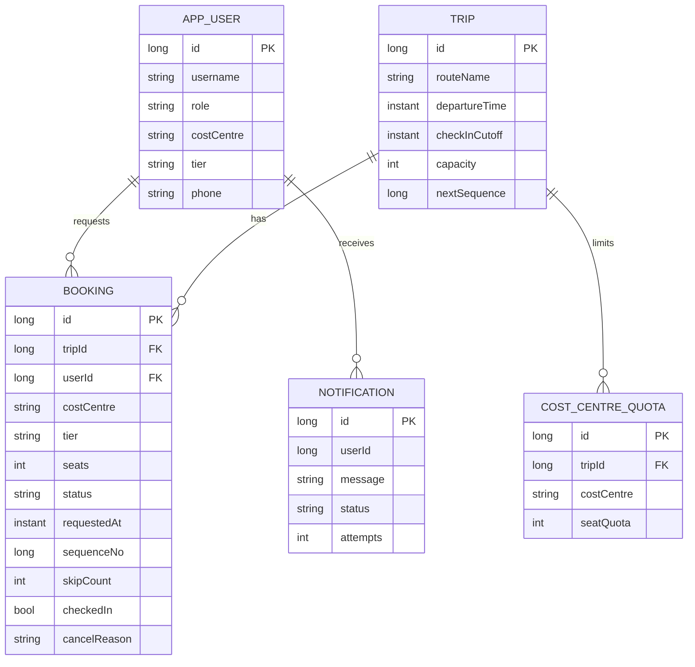

# Shuttle Waitlist & Fair Seat Promotion  (MoveInSync Case Study 5)

Spring Boot 3.5 / Java 17 backend. When a shuttle is full, employees join a waitlist; when a seat frees, the
**right** next person (or group) is promoted - fairly, instantly, never over-booking, respecting BOTH vehicle capacity
and per-cost-centre quota.

## 1. Quick start
```bash
java -version      
mvn -version      
mvn clean verify   
mvn spring-boot:run
```
App: http://localhost:8080  - H2 file DB in `./data` (delete it to reset). Demo users (seeded): see `docs/TEST_FLOW.md`.
Structured JSON logs: `mvn spring-boot:run -Dspring-boot.run.profiles=json`.
Override JWT secret: `APP_JWT_SECRET=<32+ chars>` (env) .

## 2. Domain model (ER)

States: `CONFIRMED`, `WAITLISTED`, `CANCELLED` (cancel reason `USER | ADMIN | NO_SHOW`).
A **group of 5 is ONE booking with `seats=5`** -> it is structurally impossible to half-seat a group.

## 3. How "who is next?" is decided
1. **Order** (`WaitlistOrder`): request time (1 s resolution) -> employee tier (PLATINUM>GOLD>SILVER>STANDARD) -> server sequence number. Tier only matters inside the same second, so nobody starves.
2. **Promotion pass** (`PromotionPlanner`, pure logic, unit-tested) walks the list in that order:
   - cost-centre quota exhausted -> skip (a seat may exist but the cap blocks it; others behind can still go)
   - not enough vehicle seats (group) -> skip, and count a "skip" if someone behind gets promoted
   - already overtaken `max-skips-before-reservation` (3) times -> **stop and reserve** the free seats for it (anti-starvation)
   - otherwise promote all of its seats at once.
3. A pass runs after **every** change (new booking, cancel, no-show reclaim, capacity/quota change, startup reconcile), so the invariant "nobody waitlisted could be seated right now" always holds. A new request is simply inserted as WAITLISTED and run through the same pass - it can never jump the queue or steal reserved seats.

## 4. Concurrency (the part that usually breaks)
Every seat-affecting operation does `SELECT ... FOR UPDATE` on the **Trip row** first (`TripRepository.findByIdForUpdate`), then reads usage, mutates, promotes and commits. All writers for one trip are serialised by the database (also correct with several app instances); different trips run in parallel.
Usage (`SeatLedger`) is derived from CONFIRMED rows under that lock, so there is no counter that can drift.
Proven by `SeatConcurrencyTest`: 20 threads racing for the last seat -> exactly 5/5 seats; two simultaneous cancels -> exactly two promotions in fair order; concurrent cancels never split a group.

## 5. API (Bearer JWT; `Authorization: Bearer <token>`)
| Method & path | Roles | Purpose |
|---|---|---|
| POST `/api/auth/register` | public | self-register as EMPLOYEE |
| POST `/api/auth/login` | public | get JWT |
| POST `/api/admin/users` | ADMIN | create ADMIN / APPROVER / EMPLOYEE |
| POST `/api/admin/trips` | ADMIN | create trip (capacity, departure, check-in cut-off) |
| PUT `/api/admin/trips/{id}/capacity` | ADMIN | change capacity (promotes if raised) |
| PUT `/api/trips/{id}/quotas` | ADMIN, APPROVER | set cost-centre quota (promotes if raised) |
| GET `/api/trips`, `/api/trips/{id}` | any | list / read trips |
| GET `/api/trips/{id}/availability` | any | seats, waitlist size, quota usage (**cached**) |
| GET `/api/trips/{id}/waitlist` | ADMIN, APPROVER | ordered waitlist |
| POST `/api/trips/{id}/bookings` | any | book 1..N seats (`{"seats":2,"groupLabel":"team"}`) |
| GET `/api/bookings/me`, `/api/bookings/{id}` | owner / ADMIN | read |
| POST `/api/bookings/{id}/cancel` | owner / ADMIN | cancel + auto-promote |
| POST `/api/bookings/{id}/check-in` | owner / ADMIN | check in before cut-off |
| POST `/api/admin/trips/{id}/reclaim` | ADMIN | run no-show reclaim now (also automatic) |
| GET `/api/admin/notifications` | ADMIN | SMS outbox |
| POST `/api/admin/backup`, `/api/admin/reconcile` | ADMIN | backup DB / self-heal + invariant check |
| `/actuator/health` (public), `/actuator/metrics`, `/actuator/prometheus` | ADMIN | monitoring |

## 6. Plus points - where each is implemented
| # | Criterion | Implementation |
|---|---|---|
| 1 | Authentication / RBAC | BCrypt + stateless JWT (`security/`), roles EMPLOYEE / APPROVER / ADMIN via `@PreAuthorize`; owner checks in `BookingService`; JSON 401/403 handlers; generic login error (no user enumeration); startup fails if secret < 32 chars |
| 2 | Complexity | see section 7 |
| 3 | Failure handling | row-lock serialisation; transactional **outbox** for SMS with retry (`NotificationService`, `NotificationListener`); lock timeout -> `503 + Retry-After`; startup/periodic `ReconciliationService` (re-promote + verify invariants); H2 file DB + online `BackupService`; per-trip isolation in jobs |
| 4 | OOP / layering | controller (`web`) -> service -> repository; `SmsGateway` interface with swappable impl; pure domain classes (`SeatLedger`, `WaitlistOrder`, `PromotionPlanner`) |
| 5 | Trade-offs | section 8 |
| 6 | Monitoring | Micrometer `shuttle.*` counters/timer/gauge, Prometheus endpoint, request-id MDC + structured access log, JSON log profile |
| 7 | Caching | Caffeine cache `tripAvailability`, evicted **after commit** on every change + 10 s TTL, max 500 entries. Stale: availability may lag by <= 10 s only if another node wrote it or a reader raced the commit. Bookings/waitlist are never cached |
| 8 | Errors | `GlobalExceptionHandler`: stable `{code,message,violations,requestId}`; no stack traces/SQL leaked; 500 returns only a reference id |

Metrics: `shuttle.booking.confirmed|waitlisted|cancelled{reason}`, `shuttle.promotion.total`, `shuttle.promotion.skipped{reason=quota|capacity|starvation_reservation}`, `shuttle.noshow.reclaimed`, `shuttle.request.rejected{code}`, `shuttle.notification.sent|failed`, `shuttle.waitlist.size`, `shuttle.invariant.violation`, `shuttle.promotion.pass.duration`.

## 7. Complexity (n = bookings of ONE trip, W = waitlisted)
- Ledger load: one grouped SQL, O(n) DB work, O(#cost-centres) memory.
- Promotion pass: sort O(W log W) + one scan O(W); memory O(W). Fast path O(1) extra when the bus is full.
- Booking / cancel / check-in: one pass + O(1) row writes. Waitlist position: O(W log W).
- Cache hit for availability: O(1).

## 8. Trade-offs
- **Pessimistic trip lock vs optimistic retry / Redis lock**: simplest provably-correct option; throughput is limited per trip (fine: one bus = tens of seats) and trips scale independently. Optimistic versioning would need retry storms on the hot "last seat" row.
- **Derived usage vs stored counters**: slightly more SQL, zero drift risk.
- **Group = one row**: no partial fills; policy = all-or-nothing + bounded skipping, so a large group may wait while small requests pass it up to 3 times, after which seats are reserved (seats can sit idle until the group fits - chosen over starvation).
- **Tier tiebreak only inside 1 s**: preserves FIFO fairness; a bucket larger than 1 s would favour tiers more.
- **No quota row = no cost-centre cap** (vehicle capacity still applies).
- **Outbox + at-least-once SMS**: never lose a notification, a duplicate is possible after a crash mid-send; single-node dedupe via a lock.
- **H2 file DB** for easy setup; switch URL/driver to PostgreSQL for production (`FOR UPDATE` semantics identical). Backup uses H2 `BACKUP TO`.
- Seats granted after the check-in cut-off are auto-checked-in (otherwise they would be reclaimed immediately).
- Bookings are closed once the cut-off passes; cancels are closed after departure.

## 9. Assumptions
Cut-off < departure; one active booking per employee per trip; a booking's cost centre/tier are snapshotted at request time; an employee books for their team via `seats` (members are not separate accounts); SMS is simulated (logged) - plug a real provider into `SmsGateway`.

## 10. Backup / recovery runbook
- Backup: `POST /api/admin/backup` (also hourly) -> `./backups/shuttle-<ts>.zip`.
- Restore: stop app -> delete `./data` -> unzip the backup into `./data` (it contains `shuttle.mv.db`) -> start app. On start the reconciler (5 s later) re-runs promotion passes and verifies invariants; check `shuttle.invariant.violation == 0`.
- Crash mid-request: the transaction rolls back (no half-promotion). Pending SMS rows are retried every 15 s.
- 503 `TEMPORARILY_BUSY`: lock wait timeout; client retries after `Retry-After`.

## 11. Tests
`mvn test` : `WaitlistOrderTest` (order + tiebreaker proof), `PromotionPlannerTest` (spec example, quota, group, starvation), `SeatConcurrencyTest` (races), `QuotaAndReclaimTest` (quota, no-show, permissions), `SecurityApiTest` (401/403/400, end-to-end).

See `docs/TEST_FLOW.md`, `docs/DEMO_SCRIPT.md`, `docs/GIT_COMMANDS.md`.
