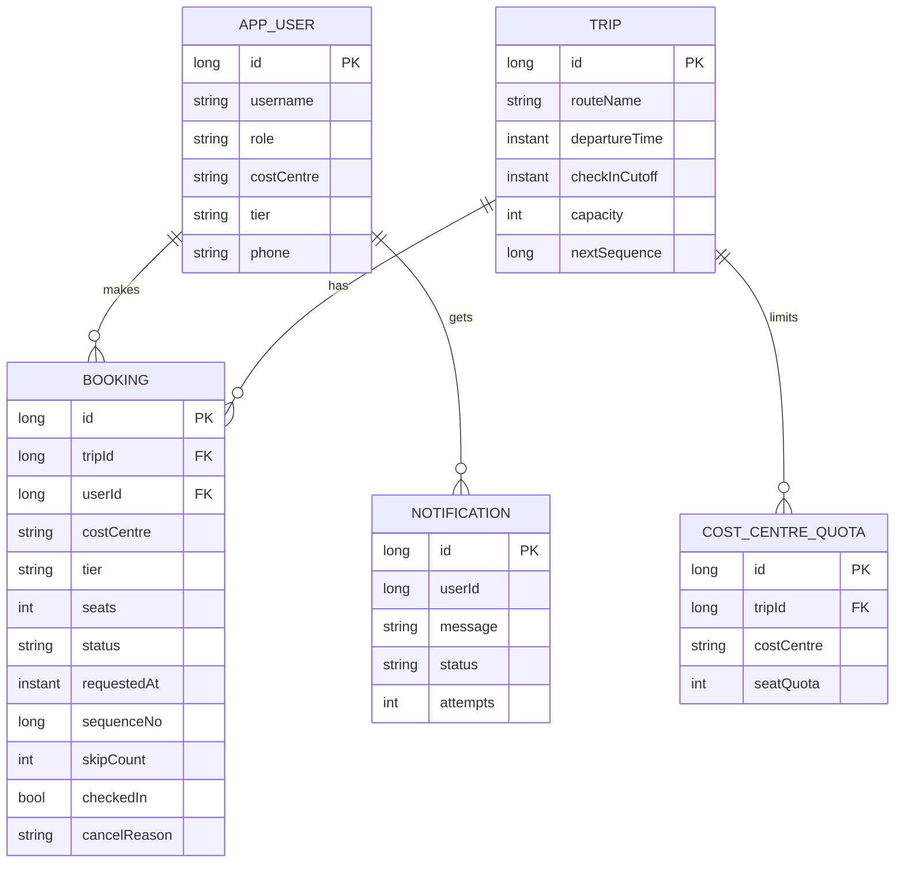

# Shuttle Waitlist & Fair Seat Promotion

Backend for MoveInSync Case Study 5, built with Java 17 and Spring Boot 3.5.

Demo Video: https://drive.google.com/file/d/1K-kGLPxLdw3nVRmPbcwaA_nmIjzpIWxX/view?usp=sharing

An office shuttle has a fixed number of seats. Once it is full, people go on a waitlist. When someone cancels (or doesn't show up), the freed seat goes to the right waitlisted person, without ever seating two people on the same seat. Groups and per-cost-centre quotas make the "who is next" question harder than plain FIFO, and most of this project is about getting that part right.

## Running it

You need JDK 17+ and Maven 3.9+.

```bash
mvn clean verify          # build and run all tests
mvn spring-boot:run       # starts on http://localhost:8080
```

- Data is stored in an H2 file database under `./data`. Stop the app and delete that folder to start fresh.
- For JSON logs: `mvn spring-boot:run -Dspring-boot.run.profiles=json`
- JWT secret can be overridden with the `APP_JWT_SECRET` env variable (at least 32 characters).

### Demo users (created on first start)

| Username | Password | Role | Cost centre | Tier |
|---|---|---|---|---|
| admin | Nitin7880 | ADMIN | IT | PLATINUM |
| approver | Approver7880 | APPROVER | IT | GOLD |
| suraj | Suraj7880 | EMPLOYEE | SALES | PLATINUM |
| rahul | Rahul7880 | EMPLOYEE | SALES | GOLD |
| ajay | Ajay7880 | EMPLOYEE | SALES | STANDARD |
| mohit | Mohit7880 | EMPLOYEE | MARKETING | STANDARD |
| aman | Aman7880 | EMPLOYEE | MARKETING | SILVER |
| raj | Raj7880 | EMPLOYEE | FINANCE | STANDARD |
| himanshu | Himanshu7880 | EMPLOYEE | FINANCE | GOLD |

These are for local demo only. Turn the seeder off with `app.seed.enabled=false` anywhere else.

## Data model



Booking states are `CONFIRMED`, `WAITLISTED` and `CANCELLED`. A cancelled booking also stores why (`USER`, `ADMIN` or `NO_SHOW`), so I did not need a fourth state.

A group of five is stored as a single booking with `seats = 5`. That way it is either fully confirmed or fully waitlisted. There is no state in which half a group is seated.

## How the next person is chosen

**Order.** The waitlist is sorted by request time (to the second), then by employee tier, then by a sequence number the server hands out. Tier only decides between requests that arrived in the same second, so a later PLATINUM request never jumps ahead of an earlier STANDARD one. That is also how starvation is avoided.

**Promotion pass.** After every change to a trip, the code goes through the waitlist in that order:

1. If the person's cost-centre quota is already used up, skip them. A seat can be free and still blocked by the quota, and this does not hold up the people behind them.
2. If the booking needs more seats than are free (a group), skip it.
3. If a booking has been passed over 3 times and still doesn't fit, stop and keep the free seats for it, so a big group can't wait forever.
4. Otherwise confirm it, all seats at once, and queue an SMS.

The same pass runs after a new booking, a cancel, a no-show reclaim, a capacity change and a quota change. A new request is first saved as waitlisted and then goes through the same pass, so it can't cut the line or take seats reserved for someone else. The logic lives in `PromotionPlanner` and `WaitlistOrder`, which have no Spring dependencies and are unit tested directly.

## Concurrency

Every operation that touches seats starts with `SELECT ... FOR UPDATE` on the trip row. It then reads usage, changes bookings, runs the promotion pass and commits. So all changes to one trip happen one at a time, while different trips don't block each other. Used seats are always counted from the confirmed bookings under that lock instead of being kept in a counter, so there is nothing that can go out of sync.

`SeatConcurrencyTest` covers the cases from the case study: 20 threads fighting for the last seat, two cancellations at the same moment, and several cancellations while a group waits.

## API

All endpoints except register, login and health need `Authorization: Bearer <token>`.

| Endpoint | Who | What it does |
|---|---|---|
| `POST /api/auth/register` | anyone | Register as an employee |
| `POST /api/auth/login` | anyone | Get a JWT |
| `POST /api/admin/users` | ADMIN | Create a user with any role |
| `POST /api/admin/trips` | ADMIN | Create a trip |
| `PUT /api/admin/trips/{id}/capacity` | ADMIN | Change capacity |
| `PUT /api/trips/{id}/quotas` | ADMIN, APPROVER | Set a cost-centre quota |
| `GET /api/trips`, `GET /api/trips/{id}` | any user | Read trips |
| `GET /api/trips/{id}/availability` | any user | Free seats, waitlist size, quota usage (cached) |
| `GET /api/trips/{id}/waitlist` | ADMIN, APPROVER | Waitlist in order |
| `POST /api/trips/{id}/bookings` | any user | Book `{"seats":2,"groupLabel":"team"}` |
| `GET /api/bookings/me`, `GET /api/bookings/{id}` | owner, ADMIN | View bookings |
| `POST /api/bookings/{id}/cancel` | owner, ADMIN | Cancel and promote |
| `POST /api/bookings/{id}/check-in` | owner, ADMIN | Check in before the cut-off |
| `POST /api/admin/trips/{id}/reclaim` | ADMIN | Run no-show reclaim now |
| `GET /api/admin/notifications` | ADMIN | See queued and sent SMS |
| `POST /api/admin/backup` | ADMIN | Back up the database |
| `POST /api/admin/reconcile` | ADMIN | Re-check trips and invariants |
| `/actuator/health` | anyone | Health check |
| `/actuator/metrics`, `/actuator/prometheus` | ADMIN | Metrics |

## Evaluation criteria and where to find them

**Authentication.** Passwords are hashed with BCrypt and login returns a signed JWT. Roles are EMPLOYEE, APPROVER and ADMIN, enforced with `@PreAuthorize`, and bookings can only be touched by their owner or an admin. A wrong login always gives the same message, so you can't tell whether a username exists. The app refuses to start if the JWT secret is shorter than 32 characters. Code is in `security/`.

**Complexity.** `n` is the number of bookings on one trip and `W` is how many of them are waitlisted.
- Loading usage is one grouped query, O(n).
- A promotion pass sorts the waitlist, O(W log W), then scans it once. If the bus is full it returns right away.
- Booking, cancelling and checking in cost one pass plus a few row writes.
- A cached availability read is O(1).

**Failure handling.**
- Every change runs in one transaction, so a crash can't leave a half-finished promotion.
- SMS messages are written to an outbox table in the same transaction and sent after commit. If sending fails, they are retried every 15 seconds, up to 5 attempts.
- A lock timeout returns `503` with `Retry-After`.
- On startup and every minute, `ReconciliationService` re-runs the promotion pass and checks that no trip is over capacity or over quota.
- `BackupService` creates an H2 backup zip every hour or on request.
- If one trip fails in a background job, the others carry on.

**OOP and layering.** Controller, service and repository are kept separate. SMS sending sits behind the `SmsGateway` interface, so the logging version can be replaced with a real provider. The core rules are plain Java classes with no framework code.

**Monitoring.** Micrometer counters are exposed at `/actuator/metrics` and `/actuator/prometheus`:
- `shuttle.booking.confirmed`, `shuttle.booking.waitlisted`, `shuttle.booking.cancelled`
- `shuttle.promotion.total`, `shuttle.promotion.skipped` (tagged by quota, capacity or reservation)
- `shuttle.noshow.reclaimed`, `shuttle.request.rejected` (tagged by error code)
- `shuttle.notification.sent`, `shuttle.notification.failed`
- `shuttle.waitlist.size`, `shuttle.invariant.violation`, `shuttle.promotion.pass.duration`

Every request gets an id that shows up in the logs and in the `X-Request-Id` header.

**Caching.** Only trip availability is cached (Caffeine, up to 500 trips, 10 second expiry). The entry is dropped right after any change commits. The data that can be stale is the free seat count and waitlist size, and only briefly: if another app instance made the change, or if a read happened to overlap a commit. Bookings and the waitlist itself are never cached.

**Error handling.** `GlobalExceptionHandler` returns the same JSON shape for every error: `code`, `message`, `requestId` and field-level `violations` where relevant. Stack traces and SQL never reach the client, and an unexpected error only returns a short reference id that matches a line in the logs.

## Trade-offs

- **Row lock instead of optimistic locking.** The "last seat" row is exactly where optimistic retries would pile up. A lock per trip is simple and correct, and one bus only has a few dozen seats, so contention isn't a real problem. The cost is that writes to a single trip are sequential.
- **Seats counted from bookings, not stored.** A bit more SQL per request, but nothing to repair after a bug or crash.
- **Groups are never split.** A big group can be passed over by smaller requests, at most 3 times. After that its seats are held for it, which can leave a seat empty for a while. I preferred that to a group waiting forever.
- **Tier only breaks ties within one second.** A longer window would favour higher tiers more, but would start hurting the FIFO guarantee.
- **No quota row means no cost-centre limit.** The vehicle capacity still applies.
- **SMS is at-least-once.** A message is never lost, but a crash right after sending could cause a duplicate.
- **H2 file database** keeps setup trivial. For production I would switch to PostgreSQL by changing the driver and URL; `FOR UPDATE` works the same way.
- **Seats given after the check-in cut-off are auto-checked-in.** Otherwise the reclaim job would take them back straight away.

## Assumptions

- The check-in cut-off is before departure. Bookings close at the cut-off and cancellations close at departure.
- An employee can have only one active booking per trip. A team books through one person using `seats`.
- Cost centre and tier are copied onto the booking when it is made.
- SMS is simulated by writing to the log. Set `app.sms.failure-probability` to see the retry behaviour.

## Backup and recovery

- Backup: `POST /api/admin/backup` writes a zip into `./backups`.
- Restore: stop the app, delete `./data`, unzip the backup into `./data`, start the app. After about 5 seconds the reconciler runs, and `shuttle.invariant.violation` should stay at 0.
- If a request fails with `503 TEMPORARILY_BUSY`, nothing was changed and it is safe to retry.

## Tests

`mvn test` runs:
- `WaitlistOrderTest`: FIFO, tier tiebreak, no starvation.
- `PromotionPlannerTest`: the example from the case study (one seat frees, group of 2 skipped), quota blocking, groups, reservation.
- `SeatConcurrencyTest`: last-seat race, simultaneous cancels, groups under load.
- `QuotaAndReclaimTest`: quota, duplicate booking, no-show reclaim, permissions.
- `SecurityApiTest`: 401, 403, 400 and a basic end-to-end booking.

More detail is in `docs/TEST_FLOW.md`.
